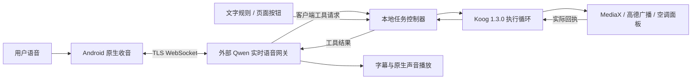

# Koog Cockpit 0.3.0

Android 13 车机座舱：Qwen 实时语音前端 + 车机本地 Koog 执行器 + MediaX / 高德适配。

这是从现有验证工程提取的 **Koog 独立源码快照**。保留实际 Koog 循环、Android 宿主、React 界面及本地接口适配；省略另一套 Agent Runtime 对比工程、个人部署参数、实机记录与构建产物。此整理不改变原车机已安装的 APK。

## 当前能力

- 本地打包的横屏 WebView 座舱界面、车辆示意及 Koog 标识。
- 在线实时语音：原生收音、字幕、工具调用、语音回复、音频焦点和网关保活。
- MediaX 播放、暂停、上下曲、状态读取及新版媒体页。
- 高德车机广播适配：打开地图、搜索候选、路线与引导信息。
- 打开空调面板、已知文字指令、下班模式、任务记录和检查点。

**模型边界：** Android 端未部署本地大模型，Koog 也尚未直接调用模型 API。语音由另行部署的 Qwen 网关理解并选择客户端工具；本地文字使用规则路由。`ScriptedExecutor` 将已有调用列表交给真实 Koog 循环执行，代码中的 GPT-4o 模型描述不代表已接入 OpenAI 服务。

完整方案见 [实现方案](docs/Koog-0.3.0-实现方案.md)，验收口径见 [验证说明](docs/VALIDATION.md)。

## 架构



## 构建

需要 JDK 17 或更新版本（原工程使用 JDK 21）、Node.js 22.12+、npm、Python 3，以及 Android SDK Platform 36。Gradle Wrapper 固定为 8.14.3，首次构建会下载公开依赖。

1. 克隆仓库，进入目录。

   ```bash
   git clone git@github.com:Tanghua/koog-cockpit.git
   cd koog-cockpit
   ```

2. 配置本机 Android SDK。设置 `ANDROID_HOME`，或在未纳入 Git 的 `local.properties` 中填写自己的 `sdk.dir`。

   ```bash
   export ANDROID_HOME=/your/android/sdk
   ```

3. 安装前端依赖、生成网页资源、运行检查并构建 APK。

   ```bash
   bash scripts/build.sh
   ```

   成功标志：Gradle 输出 `BUILD SUCCESSFUL`。APK 位于 `koog-app/build/outputs/apk/debug/koog-app-debug.apk`。

4. 安装到明确选中的设备。

   ```bash
   adb -s YOUR_SERIAL install -r koog-app/build/outputs/apk/debug/koog-app-debug.apk
   ```

   成功标志：出现 `Success`，车机可打开 Koog 应用。真实媒体/导航操作要求设备安装相应厂商服务；普通 Android 模拟器无法替代车机接口验收。

## 配置在线语音

仓库默认没有语音服务器地址，也没有登录密码或 DashScope Key。语音网关必须另行部署，并兼容 Qwen Gateway 客户端协议 7.0.0、客户端工具和实时音频。

1. 在仓库外建立自己的配置文件，结构参考 `deploy/voice-access.example.json`。填写 HTTPS 服务地址及服务要求的访问凭据；不要提交真实配置文件。

2. 将配置导入已安装的 debug 应用。

   ```bash
   python3 scripts/configure-device.py --serial YOUR_SERIAL --config /private/path/voice-access.json
   ```

3. 打开应用，点击左下麦克风，按系统提示允许收音。

   成功标志：界面显示正在聆听；联网且接口正常时，说“查询当前歌曲”可获得基于真实媒体状态的回复。

配置导入后访问凭据使用 Android Keystore 加密保存，临时导入文件删除。`run-as` 配置流程仅适用于调测包，不是量产配对方案。也可以通过 Gradle 属性 `-PvoiceServerOrigin=https://YOUR_GATEWAY_HOST` 设置构建默认地址；密码仍须单独配置，不能编译进 APK。

## 目录

```text
contract/       调用与回执契约、框架验证场景
koog/           Koog 适配器及 Android 兼容检查点
koog-app/       独立 APK 入口与 Android 13 测试
cockpit-ui/     Android WebView 宿主、语音桥及车机能力
web/            React 源码及车辆示意素材
scripts/        构建与设备配置脚本
deploy/         不含真实凭据的配置示例
docs/           实现方案及验证说明
licenses/       上游许可证
```

## 已知边界

没有离线语音、唤醒词、端侧大模型自主规划、WorkBuddy 任务接入或完整地图嵌入。音乐曲库、播放列表及进度拖动尚未实现。空调仅打开面板。任务检查点不是统一用户长期记忆；跨会话完整聊天恢复和生产级崩溃一致性仍待建设。

这是用于 Android 车机集成验证的 debug 工程。WebView 调试、模拟框架场景入口及仅调测版音频隔离能力需在正式发布前单独治理。

## 来源与许可证

Koog 使用 Apache-2.0；界面和车机桥接源自 Qwen Audio Agent Smart Cockpit，保留其 Apache-2.0 许可。车辆模型的 CC-BY-4.0 作者与来源见 [第三方说明](THIRD-PARTY-NOTICES.md)。本仓库没有对未明确许可的自定义部分额外授予开源许可。
