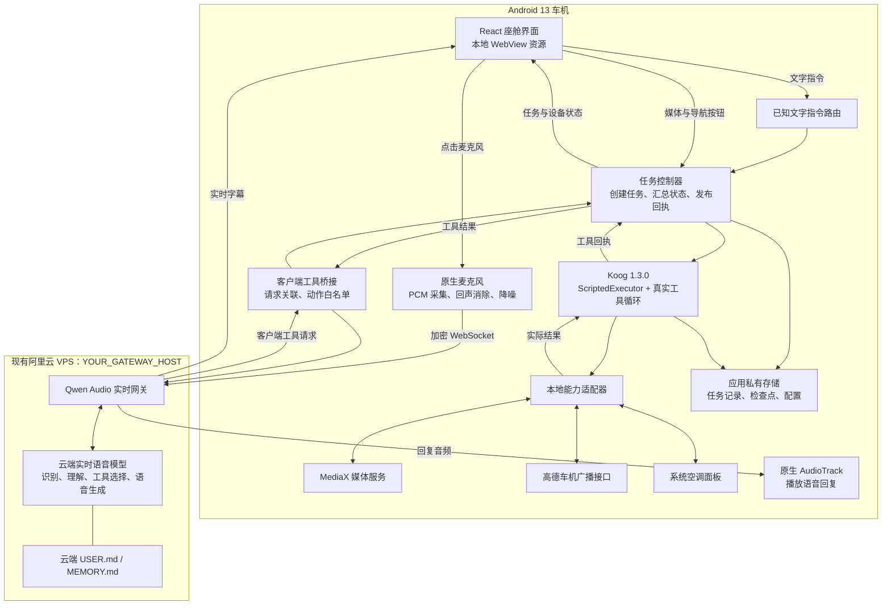
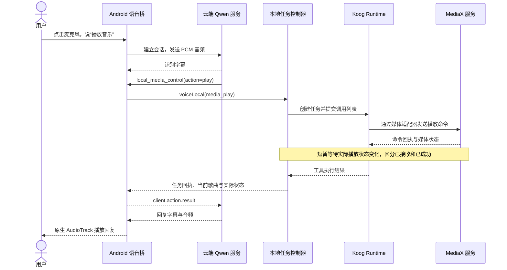

# Koog 0.3.0 车机座舱实现方案

版本：0.3.0（versionCode 5）  
整理日期：2026-11-22  
应用包名：`com.qwenaudio.validation.koog`  
适用环境：Android 13 车机，横屏布局  
工程目录：`仓库根目录`

> 本文描述已经落地的实现。代码已接入的能力、实际验收结果和后续规划分别说明，避免把框架验证等同于完整产品能力。

## 1. 方案定位

当前方案为：**Qwen 云端实时语音理解 + Android 端 Koog 工具执行 + 车机本地接口 + Qwen 风格座舱界面**。

APK 在车机上显示界面、采集声音、播放回复，并调用真实媒体和导航能力。现有阿里云 VPS 提供实时语音服务；云端模型理解语音并选择已注册的客户端工具，车机接收请求后交给 Koog 执行，再把实际回执送回云端生成回复。

### 1.1 大模型接入现状

| 项目 | 0.3.0 的实际状态 |
|---|---|
| 车机本地部署大模型 | 未部署 |
| Android 端 Koog 直接调用大模型 API | 未接入 |
| 云端实时语音模型 | 已接入现有 Qwen 服务；本次验收使用 `qwen-audio-3.0-realtime-flash` |
| Koog 的职责 | 执行已经确定的工具调用，承接工具结果，保存执行检查点 |
| 文字指令理解 | 本地规则匹配，不经过大模型 |
| 复杂任务自主规划 | 尚未落地到 Android 端 Koog |

Koog 适配器当前使用 `ScriptedExecutor`，按传入的调用列表生成工具提案，运行真实的 Koog 循环。代码中的 `OpenAIModels.Chat.GPT4o` 是框架模型描述参数；该执行器不向 OpenAI 发请求，不能据此判断已经接入 GPT-4o。

因此，现阶段已实现的是工具执行型车机 Agent，尚未实现端侧大模型驱动的完整自主 Agent。

## 2. 总体架构



图中的云端记忆属于现有语音服务，尚未与车机 Koog 的任务存储整合为统一记忆系统。

## 3. 组件与职责

| 层次 | 技术与组件 | 主要职责 |
|---|---|---|
| 界面 | React、Android WebView | 展示车辆示意、导航、媒体、任务、能力配置和设置 |
| 原生宿主 | `RuntimeCockpitActivity` | 装载本地网页、处理权限与生命周期、建立 JavaScript 桥接 |
| 语音 | `RuntimeVoiceBridge`、`useRuntimeVoice` | 收音、连接云端、处理字幕、客户端工具请求和原生声音播放 |
| 任务控制 | `CockpitController` | 动作校验、单任务调度、结果汇总、界面状态发布 |
| 框架适配 | `KoogAdapter` | 将调用列表交给真实 Koog 工具循环执行 |
| 本地接口 | `LocalCapabilities`、`LocalMedia`、`LocalCockpitApps` | 对接 MediaX、高德广播及空调页面 |
| 持久化 | 任务 JSON、Koog 检查点、SharedPreferences | 分别保存任务展示记录、执行状态和用户配置 |

React 资源随 APK 打包，通过 `WebViewAssetLoader` 从本地 HTTPS 地址装载。WebView 拒绝加载外部网页；语音网络连接由原生桥处理。

## 4. 语音交互流程

以“播放音乐”为例：



### 4.1 当前注册的客户端语音工具

| 工具 | 对应本地能力 |
|---|---|
| `local_media_control` | 播放、暂停、上一首、下一首、媒体状态读取 |
| `local_navigation_search` | 请求高德搜索目的地，显示候选地点 |
| `local_map_open` | 打开已安装的高德车机地图 |
| `local_aircon_open` | 打开系统空调面板 |

语音理解与工具选择发生在云端。车机收到工具请求后，才由本地 Koog 执行。云端模型不直接访问车机媒体服务或发送车机广播。

### 4.2 音频与连接处理

- 使用 Android 原生 `AudioRecord` 采集声音，按服务要求发送 PCM 音频；本次验收输入为 16 kHz。
- 在设备支持时启用回声消除和降噪；通过原生音量事件更新收音反馈。
- 使用原生 `AudioTrack` 播放云端回复，处理播放回执和音频焦点，避免本地音乐启动后丢失回复声音。
- 点击麦克风开启会话，再次点击关闭；进入后台停止收音。
- 主动开启时允许接替旧客户端占用的语音会话。
- 响应网关发出的保活 ping，不主动发送协议不支持的客户端 ping。
- 对已识别的“manual response already in progress”语音重叠临时错误，保留连接并提示稍作停顿；鉴权、网络和其他服务错误会提示重新开启。

此版本没有离线识别或唤醒词，也没有完成行驶噪声环境下的声学优化。

## 5. 文字与按钮操作流程

文字指令流程为：

```text
文字输入 → 本地规则匹配 → 调用列表 → 任务控制器 → Koog → 车机接口 → 实际回执
```

当前规则覆盖播放、暂停、上下曲、媒体状态、打开地图、目的地搜索和下班模式。它不支持任意自然语言输入，也没有把文字请求自动送给云端模型自由规划。

界面按钮直接指定已开放的动作，再进入相同的任务执行链路。媒体状态自动刷新属于只读状态同步，不为每次轮询创建任务。

下班模式是已知步骤组合：读取用户设置的回家目的地，先请求高德搜索，再请求播放音乐。搜索不等于开始导航；用户需要根据候选地点继续操作。执行前检查能力开关与配置代数，配置变化后阻止旧配置下的后续步骤。

### 5.1 快思考、慢思考的边界

0.3.0 没有实现一套独立的“快思考/慢思考”分类器，也没有在车机 Koog 中接入用于复杂任务的 LLM 规划器。

本地按钮和规则指令构成较直接的执行路径；语音请求增加了云端理解和工具调用过程。但不能把这两条路径直接等同于已经实现了完整的快慢思考体系。复杂任务委派到 WorkBuddy、执行长任务并异步回报的方案，尚未集成到这份 Koog APK。

## 6. 车机能力与界面实现

### 6.1 媒体

通过 AndroidX Media3 连接实际 MediaX 服务：

```text
com.txzing.mediax
com.txzing.mediax.core.service.MediaPlaybackService
```

控制操作使用媒体服务开放的自定义命令；读取返回的歌曲信息、播放状态、时长和位置。

媒体页具备：

- 专辑封面区域；服务未提供可用封面时使用唱片占位图。
- 真实歌名、歌手、专辑信息；未提供的字段显示未提供。
- 播放进度展示，以及播放、暂停、上一首、下一首按钮。
- 连接状态、操作反馈及手动刷新。
- 页面可见时每 1.5 秒刷新媒体状态。
- 紧凑屏幕布局，保证控制按钮完整可见。

播放和暂停后短暂查询实际状态，再判断是否成功。上下曲未取得足够的状态证据时，不直接宣称已确认成功。当前未实现曲库搜索、播放列表和进度拖动。

### 6.2 导航与空调

导航沿用现有高德车机广播适配，界面承载搜索候选、路线及引导信息。收到广播结果后更新任务状态，不能把“请求已发送”当作“导航已启动”。完整地图画面尚未嵌入座舱页面。

空调能力仅打开真实系统空调面板，未实现直接修改温度、风量和开关。

车辆图片是示意素材，不代表实时车辆状态；未接入的车速和天气不会显示模拟值。

## 7. 任务状态与恢复

宿主为任务创建 ID、记录步骤，并汇总以下状态：

| 状态 | 含义 |
|---|---|
| `running` | 正在执行 |
| `accepted` | 操作已接收，仍待设备状态或异步回执确认 |
| `succeeded` | 已取得成功证据 |
| `failed` | 执行失败 |
| `partial` | 多步骤任务部分完成 |
| `unknown` | 无法确认实际结果，需核对 |

应用重启时，原先未完成的任务会标记为待核对，不盲目重发。取消会停止后续步骤；已经发送到设备的操作不能据此认定已撤销。

Koog 已启用原生 Persistence，并提供 Android 兼容检查点存储适配器。框架恢复测试已验证特定故障位置的会话恢复及避免重复模拟副作用，但日常应用启动尚未实现自动扫描全部未完成任务并恢复执行的完整流程。

任务记录文件、Koog 检查点和真实设备效果之间，尚未完成生产级的崩溃一致性与跨进程协调验证。

## 8. 记忆与数据存储

### 8.1 车机本地

应用私有目录：

```text
/data/user/0/com.qwenaudio.validation.koog/
├── files/
│   ├── cockpit-tasks.json
│   └── commands/<任务ID>/runtime/checkpoints/cockpit/*.json
└── shared_prefs/
    └── cockpit.xml
```

| 信息 | 当前实现 |
|---|---|
| 任务记录 | `cockpit-tasks.json`，保存最近 60 项任务及其步骤和回执 |
| Koog 检查点 | 每个任务独立保存框架执行状态 |
| 用户配置 | SharedPreferences 保存回家目的地、下班模式开关和配置代数 |
| 页面字幕 | React 内存中保留最近 6 条消息，未保存为本地完整聊天记录 |
| 用户长期记忆 | 尚未由车机 Koog 统一管理 |

每次重新开启语音会建立新的语音会话；客户端尚未自动恢复上一轮完整聊天上下文。Koog 的执行检查点也不等于跨任务用户记忆。

### 8.2 云端

现有 VPS 语音服务中已核对存在：

```text
/var/lib/qwenaudio/data/USER.md
/var/lib/qwenaudio/data/MEMORY.md
```

它们分别用于云端用户画像与长期记忆。文件存在不代表每轮对话都会自动提取并写入记忆；具体取决于云端记忆机制及工具调用。本次未将这些文件与车机任务记录、Koog 检查点做统一同步，也未读取其中正文来验证记忆质量。

## 9. 部署与凭据

| 项目 | 当前配置 |
|---|---|
| 语音服务入口 | `https://YOUR_GATEWAY_HOST` |
| 实时通道 | `/api/realtime`，经 TLS WebSocket 连接 |
| APK | 独立 Koog 包，不替换原 Qwen 座舱包 |
| DashScope API Key | 保留在 VPS，不写入 APK |
| VPS 访问凭据 | 当前车机已配置，使用 Android Keystore 加密保存 |
| 新设备部署 | 需要单独配置访问凭据；单独复制 APK 不等于完成配置 |

本机调测脚本将已有访问凭据写入应用私有目录，启动后导入加密存储并删除临时文件。当前设备无需在界面输入用户名密码；这一调测流程尚不等于面向量产设备的配对与发证方案。

语音需要联网。本地文字规则与媒体按钮在车机接口可用时不依赖云端；高德在线搜索等能力还取决于地图服务及网络状态。

## 10. 验证结果与限制

| 验证项 | 结果与口径 |
|---|---|
| 构建与框架检查 | 既有 10 个 JVM/Robolectric 测试方法通过；两份独立 APK 构建成功 |
| 实机麦克风 | 已确认权限、持续 PCM 采集及非零音量反馈 |
| 查询歌曲样本 | 已跑通真实识别、客户端工具调用、Koog 任务和回复音频输出 |
| 播放音乐样本 | 实际媒体进入播放状态；Koog 任务成功；回复歌名与媒体快照一致 |
| 暂停音乐样本 | 实际媒体未播放；Koog 任务成功；助手返回“音乐已暂停” |
| 保活 | 最终样本测试后额外保持 30 秒，收到网关保活消息且连接正常 |
| 收音恢复 | 隔离样本阶段结束后，确认可恢复真实麦克风采集 |
| 最终界面 | 媒体控制按钮完整可见，未处理 JavaScript 异常为 0 |
| 安装包一致性 | 车机 base.apk 与发布 APK 的 SHA-256 一致 |

自动音频测试使用 Mac 合成的中文样本，通过车机原生通道发送到真实语音服务。为避免混入现场谈话，样本阶段使用仅调测包可用的 `debugPauseCapture` 暂停现场收音，保持真实连接及回复播放，再验证收音恢复。没有伪造识别事件或设备回执。

上述结果不等于完成了真人远场、行驶噪声环境或长时间稳定性验收；AudioTrack 写入也不能代替现场听音确认。Agent Runtime 虽共用界面代码并生成构建产物，本轮语音实机验收以 Koog 为对象。

原车机验收包及其摘要保留在本地验收档案中，未上传。仓库整理版使用外部部署配置，重新构建的 APK 摘要应单独计算。

### 10.1 主要证据文件

以下为原始本机验收档案中的文件，未上传本仓库：

- `results.json`：框架测试及 APK 摘要。
- `voice-media-latest.json`：语音、媒体、保活及收音恢复证据入口。
- `final-device-latest.json`：最终视觉检查、安装包一致性及麦克风关闭状态。
- `koog-media-preview.png`：最终媒体页预览。
- `cockpit-koog-app-0.3.0-debug.apk`：当前 Koog 安装包。

## 11. 尚未落地的能力与后续方向

| 方向 | 尚需实施的工作 |
|---|---|
| Koog 直接对接云端模型 | 用真实模型执行器替换 ScriptedExecutor，验证工具选择、参数约束、循环终止、取消与结果回传 |
| 车机本地模型 | 根据硬件资源选择推理方案，另行验证性能、模型体积与离线工具调用质量 |
| 离线语音与唤醒 | 接入本地 ASR/TTS、唤醒检测及在线/离线切换 |
| 统一记忆 | 区分用户偏好、对话历史、任务状态，建立保存、检索、同步与删除机制 |
| 复杂后台任务 | 设计慢任务判断、委派、进度、取消和异步播报；再接入 WorkBuddy 等后端 |
| 地图与音乐扩展 | 获取可用的地图嵌入、曲库、播放列表及跳播接口 |
| 产品稳定性 | 专项验证来电、蓝牙、ACC、电源恢复、长时间弱网及存储恢复 |

这些属于后续设计方向，不是 0.3.0 已具备的功能。

## 12. 关键代码入口

工程根目录：`仓库根目录`。

| 文件或组件 | 用途 |
|---|---|
| `web/src/main.jsx` | 主界面与本地操作入口 |
| `web/src/useRuntimeVoice.js` | 实时语音会话及客户端工具分发 |
| `web/src/components/LocalMediaPanel.jsx` | 媒体播放器界面 |
| `cockpit-ui` 中的 `RuntimeCockpitActivity.kt` | Android 宿主及任务控制器 |
| `cockpit-ui` 中的 `RuntimeVoiceBridge.java` | 原生收音、网络与回复播放 |
| `cockpit-ui` 中的 `LocalMedia.java`、`LocalCockpitApps.java` | 真实车机媒体及应用接口适配 |
| `koog` 中的 `KoogAdapter.kt` | 真实 Koog 循环与当前固定提案执行器 |
| `koog` 中的 `AndroidCompatibleCheckpoints.kt` | Android 兼容检查点存储 |

仓库内验收口径见 `docs/VALIDATION.md`；原界面来源及素材许可证见 `THIRD-PARTY-NOTICES.md`。


## 仓库发布说明

本仓库仅提取 Koog 相关模块，省略 Agent Runtime 对比模块、实机日志、录音、APK、个人路径与部署地址。服务器地址改由本地配置或构建属性提供。原始验收档案与安装包未上传；原车机安装不受此整理影响。
